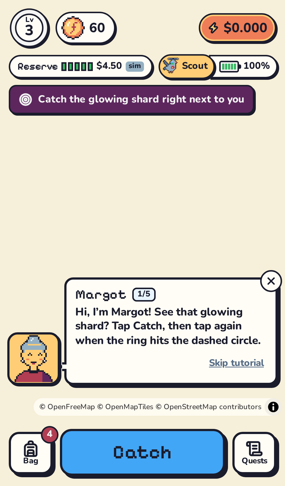
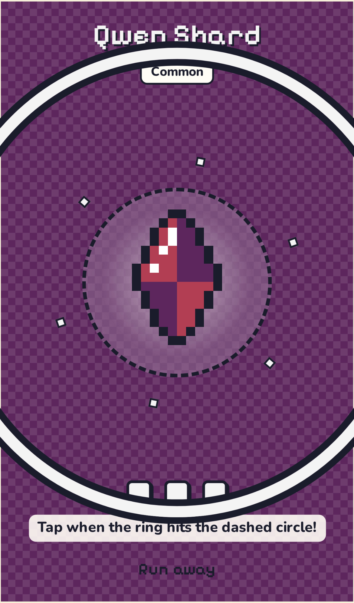

# TokenGo — Walk Paris. Catch AI. Spend it for real.


**TokenGo is a location-based browser game where the loot is real AI compute.** Shards of Claude, GPT, DeepSeek, Gemini and Qwen
spawn around real Paris landmarks. AI merchants — each with its own NEAR account — buy and sell them at prices driven by local supply
and demand, so the same shard is cheap at one café and expensive near the Louvre. Walk the spread, fill a Forge recipe, and compile it
into **real NEAR AI Cloud credits on your own API key**. No wallet, no seed phrase, no gas: just play.

Built for the NEAR HACKATHON — tracks **games** and **agents**.

| | | | |
|---|---|---|---|
|  |  |  |  |
| Map (Remote Scout) | Lock-on catch | "Why this price?" | Real credit ticket |

---

## Live demo
- **Play:** _(URL added at deploy time)_ → "Play for real · GPS" (works anywhere: outside Paris the server maps your neighbourhood from OpenStreetMap on the fly) or "Remote Scout" (no GPS needed: fly a battery-limited courier pigeon over Paris from your couch).
- **Judges' pass:** `/?demo=1&k=<DEMO_TOKEN>` (link given in the submission) → a level-7 demo account with a full bag, to see
  Prism/Aura compiles and merchant rescues in one minute, paid in **real** credits from the Judge pool ($0.20 max per account).
- **City Pulse** (`/pulse`, no account): live ticker, Paris Shard Index, reserve, merchants going bankrupt, on-chain settlements.
- **Economy Lab** (`/lab`, no account): simulate a week of Paris with 200 bots in seconds, using the exact live rules.

## Why it's a game with a real economy
- **Walking is arbitrage.** Every merchant has its own stock and therefore its own prices. The same family can differ by 15–40 % between
  two merchants 600 m apart — the "Best known price" comparator only shows prices you have actually seen.
- **The economy is the gameplay.** Prices follow scarcity (`(target/stock)^α`), merchants import, export, pay rent, go bankrupt, and are
  rescued by players (Patrons). Daily Forge recipes create demand shocks around landmarks.
- **One real door, protected.** Flux (soft currency) is never convertible. The only way to real value is the Forge, which burns shards
  from several families/places. Payouts are a *fraction of what remains* in the reserve → the game is **solvent by construction**.
- **AI merchants with bounded agency.** An LLM (NEAR AI Cloud) adjusts each merchant's margin, targets and contracts every 3 h — inside
  hard clamps. It never moves value; every number shown in "Why this price?" comes from the rules.
- **A living world.** 24 runner-agents walk the real map, trade and rescue merchants around the clock (badged "agent", never paid real credits).

## Try it in 5 minutes (no secrets needed)
Requirements: Node ≥ 24, npm 11.
```bash
npm install
npm run build          # builds the web app (served by the server)
npm run dev            # web http://localhost:5173 + API :8787 (credits simulated, chain off without .env)
```
1. Open **http://localhost:5173/?demo=1** → tap **Play as guest** → you are at the Louvre (Cour Napoléon) with a starter kit.
   Margot, a merchant, guides you in 5 one-line bubbles.
2. A glowing **DeepSeek shard** is 20 m away: tap **Catch**, then tap when the shrinking ring hits the dashed circle → "+1 DeepSeek Shard".
3. Tap the map to walk to the nearest **Relay** (fountain icon) → swipe the disc → Flux + a shard.
4. Walk to **Le Café Marly** (market stall) → tap ⓘ **Why this price?** → see the exact formula → sell 1 Gemini with *slide to confirm*.
5. Walk to the **Louvre Forge** → **First Compile** → hold the button → a credit ticket: **+$0.030 · ≈ 20 DeepSeek chats** (marked
   *simulated* without a NEAR AI account).
6. **Try it now** → Playground → ask a question with your own key.
7. Open **/lab** → scenario **DeepSeek flood** → **Simulate 1 week** → DeepSeek prices fall, merchants near the flood go bankrupt, health checks table.
8. Open **/pulse** → watch the live ticker while you trade in another tab.
9. `npm test` → **113 unit tests** (economy invariants, anti-cheat, pricing exploits, API, chain settler, NEAR AI request shapes).
10. `npm run verify` → tests + typecheck + build + headless e2e of the whole loop:
    `✔ TokenGo verified: 113 unit tests, 1 e2e flows` (smoke); `npm run e2e` runs all 18 flows.

Other commands: `npm run sim -- --days 7 --players 200 --scenario flood-deepseek --seed 42` (economy simulator CLI, health checks),
`npm run e2e` (all Playwright specs, mobile viewport), `npm run reconcile` (chain vs DB), `npm run check:secrets`.

## How NEAR is used
| Piece | What | Where |
|---|---|---|
| **NEP-245 multi-token** | One homemade contract for every item: `flux`, `shard:deepseek`, `shard:qwen`, `shard:gemini`, `shard:gpt`, `shard:claude`. Standard views + transfers, operator batch methods, idempotent `op_settle(ops, settlement_id)`, aggregated `EVENT_JSON` NEP-245 events. | [`contracts/tokengo-mt`](contracts/tokengo-mt) · deployed on **`tokengo.testnet`** ([explorer](https://testnet.nearblocks.io/address/tokengo.testnet)) |
| **An account per player and per merchant** | Sub-accounts `p-…`/`m-…`/`r-….tokengo.testnet`, created lazily, keyless (custodial by the game operator — stated honestly; "export my account" is a planned stretch). | `apps/server/src/chain/accounts.ts` |
| **Settlement** | Every value move is written to an outbox in the same SQLite transaction, then settled in batches every 8 s. **Before any real credit is granted, the Forge burn is settled on-chain** and its tx is shown as *Burn proof ↗*. Reconcile job compares on-chain balances with the DB. | `apps/server/src/chain/settler.ts`, `reconcile.ts` |
| **Proofs** | Profile › Proofs: your account on the explorer, your settled ops, and **"Verify on-chain"** which calls `mt_batch_balance_of` from your browser. | web `Proofs` |
| **NEAR AI Cloud — real credits** | The game holds a NEAR AI organisation (session obtained by **NEP-413** signature). Each player gets their own API key with a `spendLimit`; Forge payouts raise that limit. Solvency invariant checked before every grant: `Σ(limit − usage) + overshoot × keys + NPC budget + safety ≤ org balance`. | `apps/server/src/nearai/`, `game/reserve.ts` |
| **NEAR AI Cloud — merchant brains** | Merchants think with a cheap TEE model (`z-ai/glm-5.3-flash`), JSON schema output, clamped, ≤ 150 calls/day, deterministic fallback. | `nearai/brain.ts`, `economy/agent.ts` |
| **Private inference** | Playground models include TEE-verifiable ones (badged). | Credits screen |

The words *blockchain, wallet, gas, transaction* never appear in the game loop — only in Proofs and Pulse › On-chain.

## Economy rules (one readable file)
All constants live in [`packages/shared/src/economy/rules.ts`](packages/shared/src/economy/rules.ts); formulas are pure functions next to
it (`pricing.ts`, `market.ts`, `forge.ts`, `reserve.ts`, `spawns.ts`, `agent.ts`), shared by the server, the simulator and the UI.
- **Price:** `mid = P0 × clamp((target/stock)^1.1, 0.35, 3)`; buy/sell = `mid × (1 ∓ spread)`, each unit valued at the stock *after* the
  trade → buying then selling back always loses (tested on 500 random draws).
- **Merchant life (hourly):** imports when low (Flux sink), the city buys surplus (income that scales with activity), rent only when
  active; till < 150 ƒ → *closing* (2 h) → *closed*; players rescue it back to 600 ƒ → reopens, top contributor becomes Patron.
- **Reference price:** `P0` drifts toward `P0₀ × median scarcity` (Paris Shard Index), bounded to 0.6–1.4 × P0₀.
- **Forge payout:** `min(pool × 0.4 % × weight, player cap $0.25/24 h, city cap 5.5 %/day)` → geometric decay, never zero.
- **Health targets** (checked by the simulator and a test): merchant prices within 0.6–1.8 × P0, ≥ 15 % price gap between nearby
  merchants, ≥ 10 % of merchants struggle in a week but ≤ 30 % closed, Main pool drains ≤ 35 %/week.
Full design: [`Docs/03-economy.md`](Docs/03-economy.md).

## Security & anti-cheat (and honest limits)
- Server-authoritative: the client only sends intents. Spawns are deterministic (`HMAC(secret, cell, window)`) and recomputed server-side;
  quotes are single-use and bound to the merchant version (`PRICE_MOVED`); catches are keyed `(user, spawn)`.
- Movement: rolling 60 s speed → *in transit* (actions paused); impossible jumps → soft-lock + flag; action distance re-checked
  server-side; proof of walk (1.5 km) for Google accounts before the Main pool.
- Money: guests get one $0.03 First Compile (global cap 4/hour); only judge passes (`DEMO_TOKEN`, one per IP per day, cannot sell)
  draw from the Judge pool; Google accounts need 1.5 km of proof of walk for the Main pool; compiles are serialized per player and
  grants reserved inside the burn transaction (no double-spend under concurrency); per-player/day/city caps; kill switch
  `POST /api/admin/forge/pause`.
- Web: Origin check on every write, `SameSite=Lax` HttpOnly session cookie, strict CSP, rate limits per route, daily quotas,
  keys encrypted at rest (AES-256-GCM), no free-text input ever reaches the merchant LLM.
- **Limits:** browser GPS can be spoofed; we bound what cheating earns rather than pretend to stop it. Player NEAR accounts are custodial.

## Architecture
```
 Browser (React + MapLibre, pixel sprites drawn from text grids, Web Worker simulator)
   │  JSON + SSE (same origin)
 Fastify server (Node 24, TypeScript, 1 process) ── SQLite (WAL) ── outbox ──► settler ──► NEP-245 contract (NEAR testnet)
   │                                                                 
   ├─ shared pure economy rules (packages/shared) — also used by the simulator & UI
   ├─ runner-agents + merchant reflections (jobs)
   └─ NEAR AI Cloud: NEP-413 session → per-player API keys (spendLimit) · merchant brain · playground relay
```
```
apps/web        React app (map, screens, Lab, Pulse, Proofs)       apps/server   Fastify API, game logic, chain, NEAR AI
packages/shared types + economy rules + simulator                  contracts/tokengo-mt   NEP-245 contract (Rust)
data/world      Paris nodes built from OpenStreetMap               e2e/          Playwright specs     Docs/  full spec
```

## Run with real credits and chain
Copy `.env.example` to `.env`:
- **Chain:** `NEAR_CONTRACT_ID`, `NEAR_OPERATOR_ID`, `NEAR_OPERATOR_KEY` (testnet) → settlement on.
- **Real credits:** `NEARAI_AUTH_ACCOUNT` + `NEARAI_AUTH_KEY` (a mainnet account's full-access key, used only to sign NEP-413 login
  messages) → `node apps/server/scripts/nearai-spike.ts` checks everything for < $0.001.
- `MASTER_KEY` (32 bytes base64), `SESSION_SECRET`, `SPAWN_SECRET`, `TRUST_PROXY` (proxy hops, 1 on Railway/Fly), optional `GOOGLE_CLIENT_ID/SECRET`, `DEMO_TOKEN`, `ADMIN_TOKEN`.

**Deploy:** `Dockerfile` + `railway.json` (one container, SQLite on a volume at `/data`). HTTPS is required for browser geolocation.
Serverless hosts (e.g. Vercel functions) don't fit: the game needs a persistent SQLite file, background jobs and SSE.

## Hackathon disclosure
Built from 2026-11-06 to 2026-11-14 during the NEAR HACKATHON by a solo developer, with heavy AI assistance (Claude Code; art for the
splash/logo/cover generated with an image model). Map data © OpenStreetMap contributors, tiles © OpenFreeMap / OpenMapTiles.
Libraries: React, MapLibre GL, Zustand, Motion, Fastify, better-sqlite3, h3-js, near-kit, near-sdk, @noble/*, zod, arctic, Vitest, Playwright.

## License
MIT
